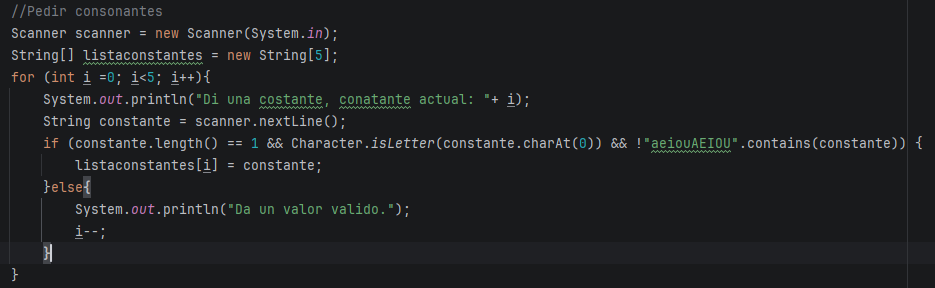
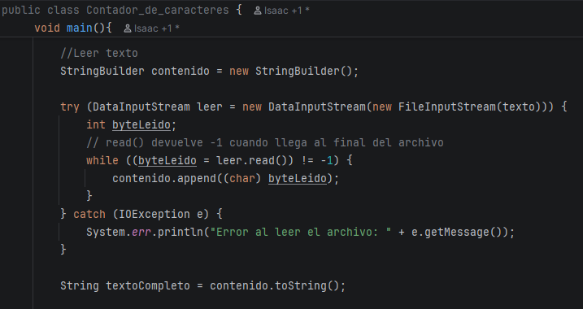

# Tarea 17 - Contador de caracteres

## Escribe un programa que pida por teclado 5 consonantes y un texto. Cada consonante tendrá un hilo que cuenta cuántas veces aparece una de las consonantes y suma sus apariciones a un contador total compartido. Al final se muestra lo que ha contado cada hilo y el total.

### Clase contador de caracteres

#### Petición de consonantes

Para la petición de consonantes primero creo un `Scanner` que leerá los inputs de teclado del usuario y una lista de String donde se guardarán los caracteres. Abro un bucle `for` que se repetirá 5 veces, dentro del bucle recibo un parámetro por teclado, abro un `if-else` y compruebo que la longitud sea de 1 carácter con `.length()`, que mediante `Character.isLetter` sea una letra real, y que no sea una vocal usando `.contains()`. Si cumple todos los requisitos lo guardo en la lista; si no, uso un `i--` para que el bucle no avance.
````java
   Scanner scanner = new Scanner(System.in);
        String[] listaconstantes = new String[5];
        for (int i =0; i<5; i++){
            System.out.println("Di una costante, conatante actual: "+ i);
            String constante = scanner.nextLine();
            if (constante.length() == 1 && Character.isLetter(constante.charAt(0)) && !"aeiouAEIOU".contains(constante)) {
                listaconstantes[i] = constante;
            }else{
                System.out.println("Da un valor valido.");
                i--;
            }
        }

````


#### Petición de texto
Para la petición del texto utilizo el `Scanner` para leer lo que escribe el usuario por el teclado y lo guardo en una variable. Después, instancio la clase `File` para crear o referenciar un archivo llamado `texto.txt`. Para escribir dentro de él de forma segura, abro un bloque `try-with` utilizando un `FileWriter` al que le paso el archivo, esto me permite escribir el texto introducido con  `.write`. Para capturar cualquier posible error de tipo `IOException` si la escritura falla.
`````java
 System.out.println("Pasame el texto: ");
        String text = scanner.nextLine();


        File texto = new File("texto.txt");
        try(FileWriter agregar = new FileWriter(texto)){

            agregar.write(text + "\n");
            System.out.println("Texto agregado");
        } catch (IOException e) {
            System.out.println("Error");
        }
`````


#### Leer el texto

Para leer el texto que acabo de guardar, primero creo un `StringBuilder` vacío llamado `contenido` que me servirá para ir acumulando todas las letras de manera eficiente.

Después, abro el archivo para lectura utilizando un bloque `try-with` con un `DataInputStream` y un `FileInputStream`. Dentro, recorro el archivo byte a byte mediante un bucle `while` que llama al método `read()`. Este método lee un byte y devuelve `-1` cuando llega exactamente al final del archivo.

En cada vuelta del bucle, convierto ese byte a carácter haciendo un casting a `(char)` y lo voy añadiendo al `StringBuilder`. Si ocurriera cualquier problema de lectura, el bloque `catch` captura la excepción `IOException` y muestra un mensaje de error por consola.

Por último, una vez que termina de leer todo el archivo, convierto el `StringBuilder` a un `String` normal utilizando el método `.toString()` y lo guardo en la variable `textoCompleto`, dejándolo listo para que los hilos puedan buscar en él.
````java
         StringBuilder contenido = new StringBuilder();

         try (DataInputStream leer = new DataInputStream(new FileInputStream(texto))) {
             int byteLeido;
             // read() devuelve -1 cuando llega al final del archivo
             while ((byteLeido = leer.read()) != -1) {
                 contenido.append((char) byteLeido);
             }
         } catch (IOException e) {
             System.err.println("Error al leer el archivo: " + e.getMessage());
         }

         String textoCompleto = contenido.toString();
````



